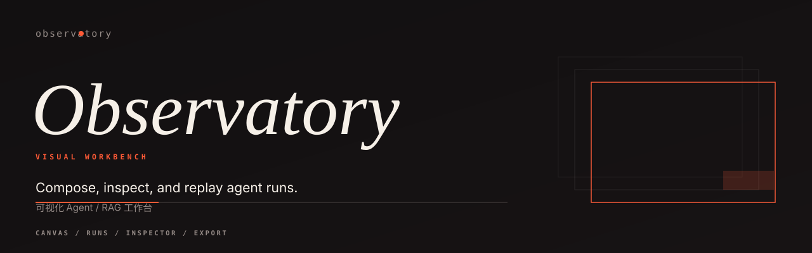
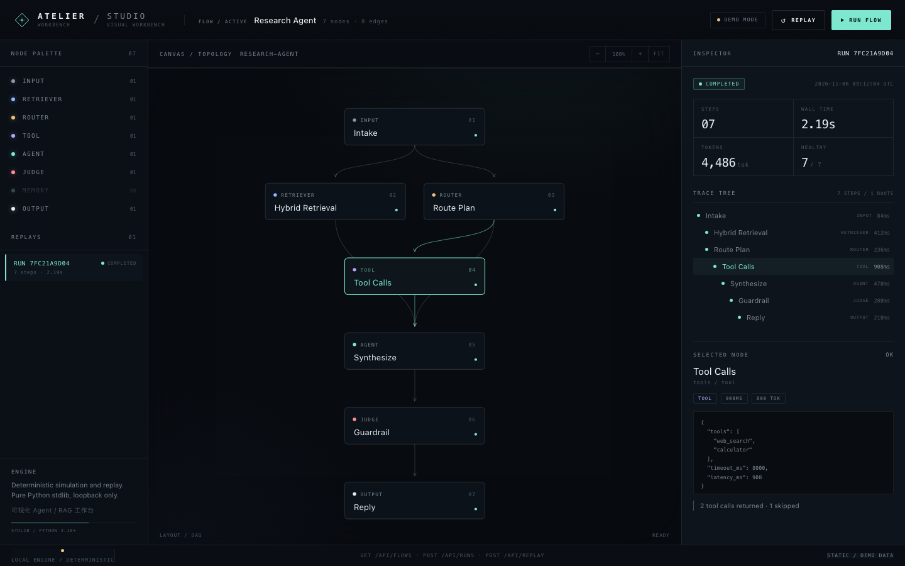

<p align="center">
  <picture>
    <source media="(prefers-color-scheme: dark)" srcset="assets/hero-dark.svg">
    <source media="(prefers-color-scheme: light)" srcset="assets/hero-light.svg">
    
  </picture>
</p>

<p align="center">
  <a href="https://www.python.org/"></a>
  
  
  
</p>

**Compose, inspect, and replay agent runs — in one window.**

Observatory is a local workbench for agent flows. The graph is drawn from a JSON
document, runs are recorded as ordered events, and the trace tree on the right is
the same data the replay slider walks through. No build step, no framework, no
CDN.

<p align="center"></p>
<p align="center"><sub>Palette · canvas · inspector, with the trace tree of a completed seven-step run.</sub></p>

## The three panes

**Left — palette.** Every node kind the engine understands: `input`,
`retriever`, `router`, `tool`, `agent`, `judge`, `memory`, `output`. Filtering is
type-ahead; the count is the number of nodes currently on the canvas.

**Centre — canvas.** The flow as SVG. Edges are routed from node to node, the
selected node is outlined in the accent colour, and `RUN FLOW` animates the
recorded order step by step.

**Right — inspector.** Run metadata on top (status, steps, wall time, tokens,
health), the trace tree underneath, and the selected node's JSON payload at the
bottom. Healthy / failed steps are counted rather than hidden.

## Run it locally

```bash
python -m pip install -e .
python -m observatory serve --port 8787
```

Then open `http://127.0.0.1:8787`. The CLI also has two offline commands:

```console
$ python -m observatory validate workspace/flows/research-agent.json
Research Agent / research-agent
nodes 7 / edges 8
order intake -> retrieve -> route -> tools -> synthesize -> guardrail -> reply
valid

$ python -m observatory summary workspace/runs/run_7fc21a9d04.json
run 7FC21A9D04 · completed · 7 steps · 4,486 tok
```

## Workspace

Everything lives in one directory: `workspace/flows/` holds flow documents and
`workspace/runs/` holds recorded runs. The `Workspace` object in
`observatory/workspace.py` is the single place that knows this layout, so the CLI,
the server and the tests never disagree about where files are.

## The two documents it reads

A **flow** is a validated DAG:

```json
{
  "id": "research-agent",
  "name": "Research Agent",
  "nodes": [
    { "id": "intake", "kind": "input", "label": "Intake" },
    { "id": "retrieve", "kind": "retriever", "label": "Hybrid Retrieval" }
  ],
  "edges": [{ "source": "intake", "target": "retrieve" }]
}
```

A **run** is an ordered list of steps, each pointing at a node:

```json
{
  "id": "7FC21A9D04",
  "flow_id": "research-agent",
  "status": "completed",
  "steps": [
    { "node_id": "intake", "kind": "input", "status": "ok",
      "latency_ms": 84, "tokens": 0, "output": {} }
  ]
}
```

`validate` rejects unknown edge targets, cycles, and unreachable nodes before the
UI ever loads the file.

## HTTP surface

The server is `http.server` from the standard library.

| Method | Path | Purpose |
| --- | --- | --- |
| `GET` | `/api/flows` | List flow documents in the workspace |
| `GET` | `/api/runs` | List recorded runs |
| `POST` | `/api/runs` | Start a run from a flow id |
| `POST` | `/api/replay` | Re-run a recorded run, linked by `replayed_from` |

## Replay and diff

Replay does not re-execute tools; it walks the recorded events and produces a new
run whose steps carry `replayed_from`. That makes two runs of the same flow
directly comparable: `runs.diff(a, b)` reports steps added, removed, or changed
in status or latency.

## Performance

`python benchmarks/bench.py`, Apple arm64, CPython 3.14.6, single process, best
of three. Synthetic workloads; indicative only.

| Workload | Per operation | Throughput |
| --- | ---: | ---: |
| Topological order, 1,000-node DAG | 0.24 ms | 4,217 orders/s |
| Trace tree build + flatten, 512 steps | 0.27 ms | 3,741 builds/s |
| Replay, 256 steps | 0.27 ms | 3,643 replays/s |
| Structural diff, 256 steps × 2 | 0.22 ms | 4,454 diffs/s |
| Run JSON serialisation, 256 steps | 0.72 ms | 1,398 serialisations/s |

## What it leaves out

No authentication, no database, no team features. Runs live as JSON files in a
workspace directory. The UI is deliberately single-file so it can be read,
forked and dropped into another tool without a bundler.
